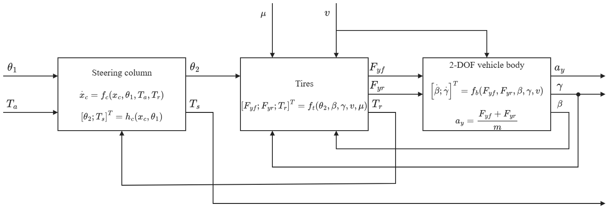
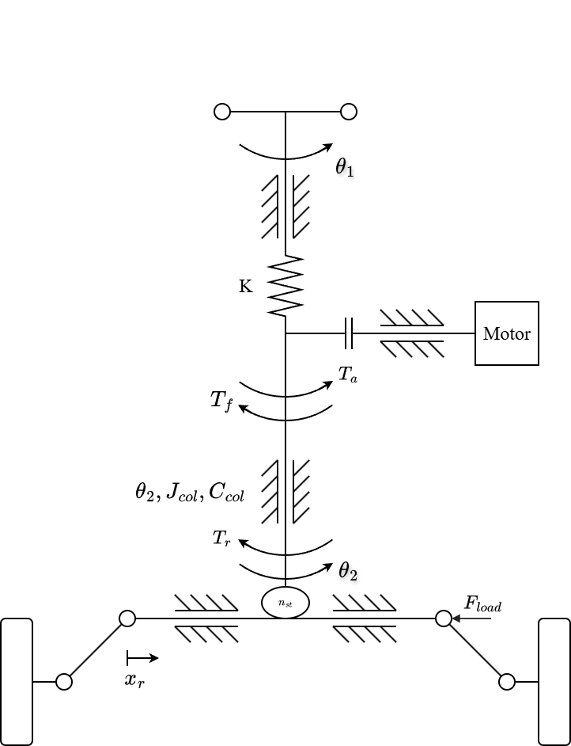
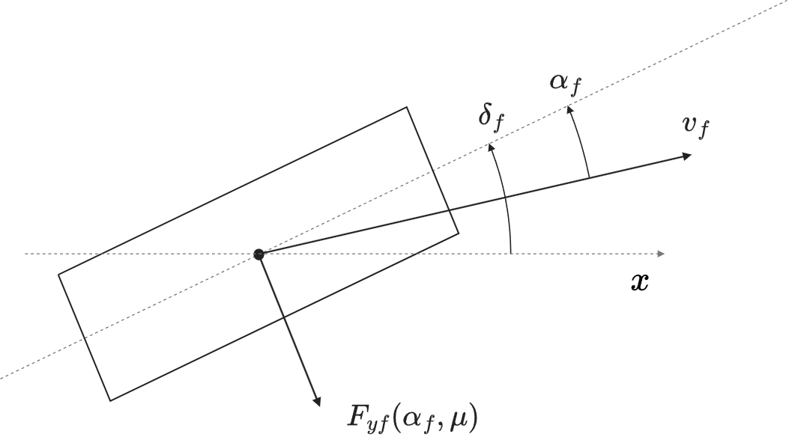

# Mục 2. System Modeling and Problem Formulation (bản viết lại)

Nhãn câu: **[2.k.n]** là câu thứ n của mục 2.k (2.0 là đoạn chuyển đầu mục); nhãn không thuộc bài.

---

## 2. System Modeling and Problem Formulation

**[2.0.1]** The three controllers compared in this paper, the map, the PID controller and MapPID, all act on the torsion-bar torque, and this torque depends on the road through the tires and the vehicle body. **[2.0.2]** A fair comparison therefore needs a plant in which a change of friction reaches the steering wheel, together with a target torque against which every controller is judged.

**[2.0.3]** The plant consists of three coupled parts, namely the steering column with its assist motor, the front and rear tires, and the lateral and yaw motion of a single-track vehicle body, and Fig. 1 shows how the three interact. **[2.0.4]** The column sets the lower-column angle $\theta_2$, which steers the front wheels, and the tires return lateral forces to the body and the road-reaction torque $T_r$ to the column, while the body feeds its sideslip angle $\beta$ and yaw rate $\gamma$ back into the tire slip angles. **[2.0.5]** Through this loop, a change in the tire–road friction coefficient $\mu$ reaches the steering wheel. **[2.0.6]** The external inputs are the steering-wheel angle $\theta_1$ set by the driver, the assist torque $T_a$, the vehicle speed $v$ and the friction coefficient $\mu$.

**Fig. 1.** Block diagram of the coupled C-EPS–vehicle plant: steering column, tires, and two-degree-of-freedom vehicle body.

### 2.1. Steering Column and Assist Motor

**[2.1.1]** The steering wheel turns the upper column, which is joined to the lower column by a torsion bar of stiffness $K$, and the torque sensor measures the difference between $\theta_1$ and $\theta_2$ and computes the torque as in Eq. (2). **[2.1.2]** The torsion bar transmits this torque to the lower column, where the motor adds the assist torque $T_a$ through a reduction gear, and $T_a$ follows the limited command $T_{a,lim}$ through the motor dynamics. **[2.1.3]** The lower column then drives the pinion, which moves the rack and, through the steering arms, steers the front wheels, and the model lumps this chain into the steering ratio $n_{st}$ between the lower-column angle and the front-wheel angle, so the pinion radius $r_p$ does not appear separately. **[2.1.4]** With $\theta_1$ taken as the driver input, the lower column and the torsion bar obey [1]

$$
J_{col}\ddot\theta_2=T_s+T_a-T_r-C_{col}\dot\theta_2-T_f\tanh(c\dot\theta_2)
\tag{1}
$$

$$
T_s=K(\theta_1-\theta_2)
\tag{2}
$$

**[2.1.5]** where $J_{col}$ and $C_{col}$ are the equivalent inertia and viscous damping of the lower column, with the motor and the gear referred to the column side, and $T_f\tanh(c\dot\theta_2)$ is a smooth form of Coulomb friction with amplitude $T_f$ and steepness parameter $c$. **[2.1.6]** Both $T_a$ and $T_r$ act directly on the column. **[2.1.7]** Figure 2 shows this arrangement.

**Fig. 2.** Mechanical structure of the column-type EPS.

**[2.1.8]** The angle is imposed, and not the driver torque, so that the torsion-bar torque can respond when the road reaction or the assist changes. **[2.1.9]** A prescribed torque would fix the steady torsion-bar torque and hide the effect under study, so the angle input gives a controlled comparison of the steering-torque responses of the controllers. **[2.1.10]** In exchange, the model leaves out the neuromuscular dynamics of the driver and the way a driver corrects the angle when the steering effort varies.

### 2.2. Tire Model and Road-Reaction Torque

**[2.2.1]** The front-wheel angle is approximated by $\delta_f=\theta_2/n_{st}$, and Fig. 3 defines the tire quantities in the road plane. **[2.2.2]** With small angles, and with a longitudinal speed that is treated as constant in the lateral equations, the slip angles of the front and rear axles are [13]

$$
\alpha_f=\frac{\theta_2}{n_{st}}-\beta-\frac{l_f\gamma}{v}
\tag{3}
$$

$$
\alpha_r=-\beta+\frac{l_r\gamma}{v}
\tag{4}
$$

**[2.2.3]** where $l_f$ and $l_r$ are the distances from the center of gravity to the two axles. **[2.2.4]** Weight transfer is neglected in both directions, so each axle carries its static load:

$$
F_{zf}=mg\,\frac{l_r}{l_f+l_r}
\tag{5}
$$

$$
F_{zr}=mg\,\frac{l_f}{l_f+l_r}
\tag{6}
$$

**[2.2.5]** where $m$ is the vehicle mass and $g$ the gravitational acceleration.

**Fig. 3.** Top view of the front tire. The dashed line through the tire is the wheel plane and the horizontal dashed line is the vehicle longitudinal axis $x$. The front-wheel steering angle $\delta_f$ is measured from $x$ to the wheel plane, the slip angle $\alpha_f$ from the wheel plane to the velocity $v_f$ of the tire, and $F_{yf}(\alpha_f,\mu)$ is the lateral force. Angles and geometry are schematic and not to scale.

**[2.2.6]** Each axle is represented by one equivalent tire whose lateral force follows a reduced Magic Formula [12]. **[2.2.7]** This form was chosen because it keeps the force saturation that a change of adhesion brings:

$$
F_{yi}=D_i\sin\!\Big[C\tan^{-1}\!\big(B_i\alpha_i-E\,(B_i\alpha_i-\tan^{-1}(B_i\alpha_i))\big)\Big],\qquad i\in\{f,r\}
\tag{7}
$$

$$
D_i=\mu F_{zi},\qquad B_i=\frac{C_{\alpha i}}{C\,D_i}
\tag{8}
$$

**[2.2.8]** where $i=f$ and $i=r$ denote the front and rear axles. **[2.2.9]** The friction coefficient $\mu$ is the same for both axles, $C_{\alpha i}$ is the cornering stiffness of axle $i$, and $C$ and $E$ set the shape and curvature of the force curve. **[2.2.10]** Since $D_i$ is tied to $\mu$ and $B_i$ contains $D_i$ in its denominator, the initial slope stays at $C_{\alpha i}$ while the peak force falls with $\mu$, and on a slippery surface the tire therefore saturates at a smaller slip angle.

**[2.2.11]** The front lateral force acts on the steering axis through an effective moment arm, which is the sum of a fixed caster offset and a pneumatic trail that shortens as the tire slides, a structure that [3] adopts for the tire offset and that the brush model of [12] supports. **[2.2.12]** The trail relation of [3] is adapted as follows:

$$
t_p=\max\!\left(0,\; t_0-\frac{t_0\,C_{\alpha f}\,\lvert\tan\alpha_f\rvert}{3\mu F_{zf}}\right)
\tag{9}
$$

$$
e_{eff}=e_c+t_p,\qquad e_c=e_{p0}-t_0
\tag{10}
$$

**[2.2.13]** where $e_{p0}$ is the moment arm at zero slip, $t_0$ the pneumatic trail at zero slip and $e_c$ the caster component. **[2.2.14]** In the notation of [3], $t_0$ is the initial pneumatic offset and $e_c$ the mechanical offset, and $C_{\alpha f}$ and $F_{zf}$ replace its tire stiffness and load, so no further tire parameter appears. **[2.2.15]** Two choices in Eqs. (9) and (10) belong to this study and not to [3], namely the zero floor on $t_p$ and the values of $e_{p0}$ and $t_0$. **[2.2.16]** The floor is needed because Eq. (9) without it reaches zero at $\tan\alpha_{sl}=3\mu F_{zf}/C_{\alpha f}$, the slip angle at which a brush tire slides over its whole contact patch [12], and turns negative beyond that angle, where the brush model places the resultant force at the patch center. **[2.2.17]** The brush-model trail starts from the same value at zero slip and also vanishes at this angle, and Eq. (9) follows it only approximately in between. **[2.2.18]** With the parameters of Table 2, this angle is $7.8^\circ$ at $\mu=0.8$ and $2.9^\circ$ at $\mu=0.3$, slightly larger than the angles of maximum lateral force, $6.3^\circ$ and $2.4^\circ$, so the trail falls to zero shortly after the tire saturates, in line with real tires, whose aligning moment drops before the lateral force peaks [12]. **[2.2.19]** The caster component stays fixed because it is a mechanical dimension that does not depend on slip or friction, so the arm shrinks to $e_c$ and the road-reaction torque keeps the sign of the lateral force at the force limit of the tire. **[2.2.20]** Some tires reverse their aligning moment at large slip angles, a behavior that these equations do not describe, so the two bounds reproduce the aligning moment of a measured tire only in part.

**[2.2.21]** The values of $e_{p0}$ and $t_0$ are estimated because no caster or trail measurement of a specific vehicle is available. **[2.2.22]** In the brush model the trail at zero slip equals one third of the contact half-length $a$, and the empirical rule in [12] puts it at about one quarter of the patch length, which gives 17 to 35 mm for an assumed $a$ of 50 to 70 mm, and $t_0=25$ mm is taken near the middle of this range. **[2.2.23]** A caster component of 23 mm is added, so that the total is $e_{p0}=48$ mm. **[2.2.24]** These dimensions were fixed before the simulations and not adjusted to their results, and since they are not measured on a particular vehicle, they set the size of the torque drop caused by a loss of friction, but not its direction.

**[2.2.25]** Referred to the column, the road reaction is

$$
T_r=\frac{e_{eff}}{n_{st}}\,F_{yf}
\tag{11}
$$

**[2.2.26]** Equations (8)–(11) therefore contain two paths by which adhesion reaches the column. **[2.2.27]** A lower $\mu$ reduces the lateral force that the front tire can develop and, at the same slip angle, shortens the pneumatic trail, and both changes lower $T_r$.

### 2.3. Single-Track Vehicle Body

**[2.3.1]** The body follows the lateral-force and yaw-moment balances of a nonlinear single-track model [13]:

$$
a_y=\frac{F_{yf}+F_{yr}}{m}
\tag{12}
$$

$$
\dot\beta=\frac{a_y}{v}-\gamma
\tag{13}
$$

$$
\dot\gamma=\frac{l_fF_{yf}-l_rF_{yr}}{I_z}
\tag{14}
$$

**[2.3.2]** where $I_z$ is the yaw moment of inertia of the vehicle. **[2.3.3]** The lateral acceleration of Eq. (12) is also the measured signal from which the target torque of Section 2.5 is computed.

### 2.4. Coupled Plant and Torque Balance

**[2.4.1]** Equations (1)–(14) form the coupled plant of Fig. 1, with the four states $\theta_2$, $\dot\theta_2$, $\beta$ and $\gamma$. **[2.4.2]** The motor, the compensator and the controller add their own states in the closed-loop simulations, but the plant states stay internal, because the controllers see only the measured torsion-bar torque, vehicle speed and lateral acceleration. **[2.4.3]** When the column is at rest, the damping and friction terms vanish and Eq. (1) reduces to

$$
T_s=T_r-T_a
\tag{15}
$$

**[2.4.4]** In steady state the motor torque also equals the limited command $T_{a,lim}$, and this command is the controller command $T_{a,cmd}$ as long as the limit is not reached. **[2.4.5]** Equations (7)–(15) thus show how the road enters the torque balance. **[2.4.6]** A lower $\mu$ lowers the tire-force capacity and the pneumatic trail, and $T_r$ falls with them, so if the assist decreases by less than $T_r$, Eq. (15) gives a smaller torsion-bar torque and the driver feels a wheel that is lighter than the road calls for.

### 2.5. Lateral-Acceleration-Based Torque Reference

**[2.5.1]** The target steering torque is taken from the steering-effort data that Li and Xia [5] report as a function of vehicle speed and lateral acceleration. **[2.5.2]** Table 1 reproduces the four acceleration levels of that study, which serve as the reference characteristic.

**Table 1.** Ideal steering-wheel torque reference (N·m), adopted from [5].

| Lateral acceleration | 20 km/h | 40 km/h | 60 km/h | 80 km/h | 100 km/h |
|---|---|---|---|---|---|
| 0.1 g | 1.0 | 1.7 | 2.1 | 2.3 | 2.6 |
| 0.2 g | 1.5 | 2.0 | 2.4 | 2.8 | 3.0 |
| 0.3 g | 1.6 | 2.3 | 2.8 | 3.1 | 3.3 |
| 0.4 g | 1.8 | 2.4 | 2.9 | 3.3 | 3.4 |

**[2.5.3]** To turn these values into a reference that can run in real time, a zero-torque point was added at zero lateral acceleration, a monotone piecewise cubic Hermite interpolating polynomial (PCHIP) was applied first over lateral acceleration and then over speed, and the result was sampled on a finer table. **[2.5.4]** Odd symmetry gives the torque for steering in the other direction, and inputs outside 20–100 km/h or 0–0.4 g are clipped to the nearest boundary:

$$
T_{ref}(v,a_y)=\operatorname{sgn}(a_y)\,\widehat T\big(v,\lvert a_y\rvert\big)
\tag{16}
$$

$$
\widehat T(v,0)=0
\tag{17}
$$

**[2.5.5]** where $\widehat T$ is the characteristic obtained for positive lateral acceleration. **[2.5.6]** The anchor at zero, the symmetry, the interpolation and the range limits are choices of this study, not of [5]. **[2.5.7]** They keep the reference continuous through straight-ahead driving and avoid extrapolating values that were never published.

**[2.5.8]** Because the reference uses only the measured speed and lateral acceleration, it needs no estimate of $\mu$ or of the rack force. **[2.5.9]** A loss of adhesion can still move the target, since lateral acceleration follows what the vehicle actually does, so the controller holds the steering effort that matches the motion the vehicle produces.

### 2.6. Torque-Tracking Objective

**[2.6.1]** All controllers share one objective, which is to bring the torsion-bar torque to the target, and in terms of the plant variables the tracking error is

$$
e_T=T_s-T_{ref}(v,a_y)
\tag{18}
$$

**[2.6.2]** In the controllers, the measured signals $T_{s,m}$, $v_m$ and $a_{y,m}$ take the place of $T_s$, $v$ and $a_y$, the subscript $m$ marking the output of the corresponding sensor model. **[2.6.3]** For a nonzero target, $\operatorname{sgn}(T_{ref})\,e_T<0$ means that the torque is below the target in the direction of the turn. **[2.6.4]** Near a steering reversal this signed reading becomes ambiguous, so measures based on magnitude replace it.

**[2.6.5]** The three controllers also work under one assist limit. **[2.6.6]** The command $T_{a,cmd}$ that leaves the controller block passes through a limit that caps it at a speed-dependent value read at the measured speed, and the limited command $T_{a,lim}$ drives the motor:

$$
\lvert T_{a,lim}\rvert\le T_{a,max}(v_m)
\tag{19}
$$

**[2.6.7]** The limit acts on the command, while $T_a$ is the torque after the motor dynamics, and its value is the assist that the dry road demands in steady state, plus a margin. **[2.6.8]** In steady state, Eq. (15) with $T_s$ at its target determines the assist needed to reach that target:

$$
T_{a,req}(v,a_y,\mu)=T_r(v,a_y,\mu)-T_{ref}(v,a_y)
\tag{20}
$$

**[2.6.9]** Since the road reaction is highest on dry road, where $\mu=0.8$, the requirement is evaluated there, over the lateral accelerations that both the plant and Table 1 cover:

$$
a_{y,lim}(v)=\min\big(a_{y,max}(v,0.8),\,0.4\,g\big)
\tag{21}
$$

**[2.6.10]** where $a_{y,max}(v,0.8)$ is the largest lateral acceleration that the dry-road plant can attain at speed $v$, bounded by tire friction and by the small-angle assumption, and $0.4\,g$ is the upper edge of Table 1. **[2.6.11]** At each $a_y$, the steady state of the plant fixes the front lateral force at $F_{yf}=m\,a_y\,l_r/(l_f+l_r)$, and Eqs. (7)–(11) then give $T_r$. **[2.6.12]** The steady-state balance ignores the Coulomb friction of the column, which can add up to its amplitude $T_f$ when it opposes the assist, so the limit includes this known bound as a margin:

$$
T_{a,max}(v)=\max_{0\le a_y\le a_{y,lim}(v)}T_{a,req}(v,a_y,0.8)+T_f
\tag{22}
$$

**[2.6.13]** The limit is computed at speeds from 20 to 100 km/h in steps of 5 km/h and interpolated linearly in between, so it is 5.7 N·m at 20 km/h, 9.8 N·m at 30 km/h and 8.5 N·m at 100 km/h. **[2.6.14]** These values come from the plant equations and do not represent the capacity of a production motor, but all three controllers meet the same limit, motor model, sensors and stability conditions, so the comparison isolates how each structure keeps the torque on target as the road and the steering input change.
