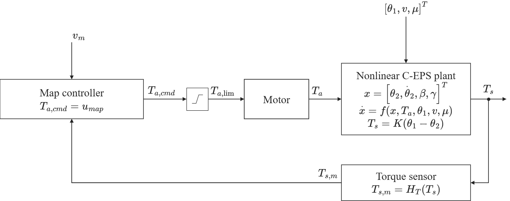
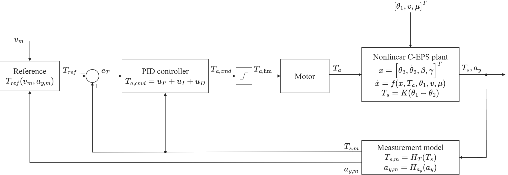
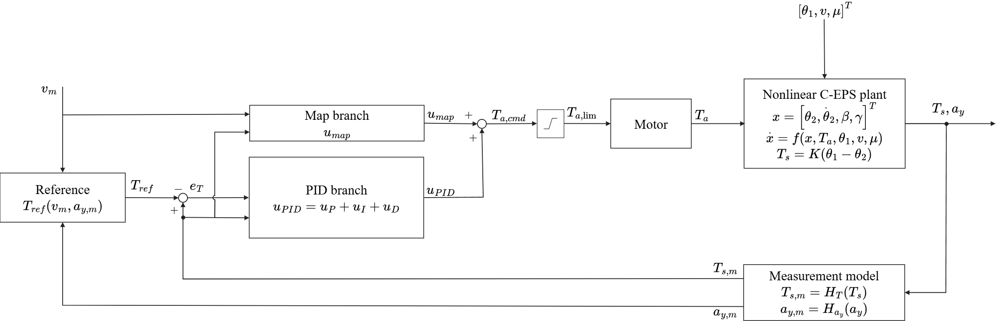

# Mục 3. Control Strategy and Assist-Map Limitation (bản viết lại)

Nhãn câu: **[3.k.n]** là câu thứ n của mục 3.k; nhãn không thuộc bài.

---

## 3. Control Strategy and Assist-Map Limitation

### 3.1. Conventional Assist-Map Control with Lead–Lag Compensation

**[3.1.1]** The conventional controller, named Map, follows the architecture described in [1]. **[3.1.2]** A two-dimensional map converts the measured torsion-bar torque and the vehicle speed
into a base assist torque, and a lead–lag compensator placed after the map keeps the loop stable. **[3.1.3]** Here $v$ is the vehicle speed of the plant and $v_m$ the speed measured by the sensor, which is the value that the controller receives, and the measured torque $T_{s,m}$ is written in the same way. **[3.1.4]** The map is calibrated on a dry road, where $\mu=0.8$, and at each calibration point
the torque equilibrium of Eq. (15) fixes the assist, since the sensed torque is set equal to the target and the motor must supply the rest of the road reaction:

$$
T_{s,cal}=T_{ref}(v,a_y)
\tag{23}
$$

$$
T_{a,cal}=T_r(v,a_y,0.8)-T_{ref}(v,a_y)
\tag{24}
$$

**[3.1.5]** The calibration covers 17 speeds from 20 to 100 km/h, spaced 5 km/h apart, and at each speed the feasible lateral accelerations are scanned in steps of 0.005 g. **[3.1.6]** Two
constraints are then imposed on the raw table, namely a dead zone and a slope limit $K_{max}$. **[3.1.7]** The dead zone sets the assist to zero while $|T_s|\le T_{s0}$, with $T_{s0}=0.3$ N·m, so
that sensor noise does not make the motor chatter when the driver hardly touches the wheel. **[3.1.8]** In addition, the slope limit $K_{max}$ caps how quickly the assist may grow with the
torsion-bar torque, so every breakpoint satisfies $\bar{M}_k\le\bar{M}_{k-1}+K_{max}(|T_s|_k-|T_s|_{k-1})$, and the table is also kept nondecreasing in torque. **[3.1.9]** The map then reads

$$
M(v,T_s)=\mathrm{sgn}(T_s)\,\bar M(v,|T_s|)
\tag{25}
$$

**[3.1.10]** where $\bar M(v,|T_s|)$ is the conditioned table for positive torque, stored for torques from 0 to 5 N·m and interpolated linearly in torque and in speed.

**[3.1.11]** The output of the map goes through a lead–lag compensator [1] ahead of the assist limit, made of a lead stage with output $w$ followed by a lag stage:

$$
\tau_{1,out}\dot w+w=\tau_{1,in}\frac{d}{dt}M(v_m,T_{s,m})+M(v_m,T_{s,m})
\tag{26}
$$

$$
\tau_{2,out}\dot u_{map}+u_{map}=\tau_{2,in}\dot w+w
\tag{27}
$$

**[3.1.12]** In Eqs. (26) and (27), $\tau_{j,in}$ and $\tau_{j,out}$ are the time constants, in seconds, multiplying the input and output derivatives of stage $j$, with $j=1$ for lead and $j=2$
for lag, while $u_{map}$ is the output of the compensator. **[3.1.13]** The lead stage shapes the response to column oscillations with a period of about 0.16 s, and the lag stage smooths rapid
torque changes before they reach the motor. **[3.1.14]** In steady state the signals settle, so $w=M$ and $u_{map}=w$, and the static characteristic of the map is left untouched. **[3.1.15]**
Figure 4 shows the loop.

**Fig. 4.** Closed-loop signal flow of the assist-map controller. The measured vehicle speed is $v_m=H_v(v)$, with $H_v$ the speed-sensor model. The controller block contains the assist map $M$ of Eq. (25)
followed by the lead–lag compensator of Eqs. (26)–(27), and its output $u_{map}$ is the command $T_{a,cmd}$. This command passes through the assist limit, which bounds it by $T_{a,max}(v_m)$, and the limited command $T_{a,lim}$ drives the motor.

### 3.2. Steady-State Limitation of Assist-Map Control

**[3.2.1]** A map calibrated on a dry road is unlikely to stay exact on a slippery one, and a brief steady-state calculation reveals how large the error becomes. **[3.2.2]** With the column at
rest, the Coulomb friction term is zero and the compensator leaves the map output as it is, so at a given speed and lateral acceleration Map satisfies

$$
T_s+M(v,T_s)=T_r(v,a_y,\mu)
\tag{28}
$$

**[3.2.3]** Suppose that the road reaction shifts by $\Delta T_r$ while speed and lateral acceleration are unchanged. **[3.2.4]** Linearizing Eq. (28) gives

$$
\Delta T_s=\frac{\Delta T_r}{1+s_m}
\tag{29}
$$

$$
s_m=\frac{\partial M(v,T_s)}{\partial T_s}
\tag{30}
$$

**[3.2.5]** where $s_m$ is the slope of the map at the operating point. **[3.2.6]** The driver feels only $1/(1+s_m)$ of $\Delta T_r$, and the map has compensated the remaining $s_m/(1+s_m)$.
**[3.2.7]** Because the target depends only on speed and lateral acceleration, the tracking error moves by the same amount as the sensed torque:

$$
\Delta e_T=\frac{\Delta T_r}{1+s_m}
\tag{31}
$$

**[3.2.8]** When friction drops from its dry value, the tire force saturates earlier and the pneumatic trail shortens, so the road reaction decreases and $\Delta T_r$ is negative. **[3.2.9]**
Since $s_m$ cannot exceed $K_{max}$, $|\Delta e_T|$ is never smaller than $|\Delta T_r|/(1+K_{max})$ and $\Delta e_T$ has the sign of $\Delta T_r$, so the torque falls below its dry-road value and the assist is too high for the road. **[3.2.10]** A larger $K_{max}$ would shrink the error, but a steeper slope also raises the loop gain, which amplifies sensor noise and makes the loop harder to
keep stable. **[3.2.11]** The slope limit also costs accuracy on the dry road, since wherever the calibration data ask for a slope above $K_{max}$, the table is flattened and supplies less assist
than Eq. (24) requires.

### 3.3. PID Steering-Torque Feedback Control

**[3.3.1]** The PID controller drops the map and works on the torque error alone. **[3.3.2]** Its starting point is the textbook law of Åström and Hägglund [14], which computes the control signal
from the error $e=y_{sp}-y$, the difference between the setpoint and the measured output:

$$
u(t)=K_p\,e(t)+K_i\int_0^t e(\tau)\,d\tau+K_d\,\frac{de(t)}{dt}=K_p\left[e(t)+\frac{1}{T_i}\int_0^t e(\tau)\,d\tau+T_d\,\frac{de(t)}{dt}\right]
\tag{32}
$$

**[3.3.3]** where $K_p$ is the proportional gain, and $T_i$ and $T_d$ are the integral and derivative times. **[3.3.4]** The right-hand expression is the standard form of [14], known as the ISA
or ideal algorithm, and the left-hand one is its parallel version, in which $K_i=K_p/T_i$ and $K_d=K_pT_d$ [14, Eqs. (3.9), (3.18)]. **[3.3.5]** The former is adopted, because the rules of [14]
for the derivative filter and the tracking time are written in $T_i$ and $T_d$ and because its complex zeros, which the series (interacting) structure lacks, are useful for processes with
oscillatory poles such as this column [14, p. 73]. **[3.3.6]** The proportional term reacts to the present error, the integral term removes the steady-state error, and the derivative term
anticipates the trend of the error and adds damping [14, Sec. 3.3].

**[3.3.7]** The law is seldom used as it stands, because modified versions perform much better [14, Sec. 3.4]. **[3.3.8]** The controller of this paper therefore departs from it in three ways,
all of them modifications described in [14].

**[3.3.9]** First, the derivative acts on the measured torque $T_{s,m}$ and not on the error $e_T=T_{s,m}-T_{ref}(v_m,a_{y,m})$, which is Eq. (18) written with measured signals and has the sign opposite to the error $e$ of [14], because more assist lowers $T_s$. **[3.3.10]**
Since $\dot e_T=\dot T_{s,m}-\dot T_{ref}$, this leaves out the derivative of the target. **[3.3.11]** This is the setpoint weighting of [14], in which the derivative is applied to $c\,y_{sp}-y$
with a factor $c$ on the setpoint, and the usual choice $c=0$ avoids large transients in the control signal when the setpoint jumps [14, Eqs. (3.19)–(3.21)]. **[3.3.12]** The proportional term
keeps the full error because the loop has to follow the target, the integral term has to see the true error to avoid a steady-state error, and [14] calls this arrangement PI-D.

**[3.3.13]** The case for $c=0$ is stronger in this loop than in [14], because the setpoint is the target torque, which is computed from the measured speed and lateral acceleration and not
entered by an operator. **[3.3.14]** The target moves quickly whenever a turn begins or ends, and it carries the noise and quantization steps of two more sensors, those of speed and lateral
acceleration. **[3.3.15]** A derivative taken of the error would convert both into spikes in the assist torque, and these would not add damping. **[3.3.16]** The derivative term exists to
suppress the oscillation of the column, which shows in $T_{s,m}$, while $T_{ref}$ varies with the steering input and the slower motion of the vehicle body. **[3.3.17]** Leaving $T_{ref}$ out
should not weaken the loop, because [14] notes that, for a setpoint independent of the loop, the factor on the setpoint alters only the behavior for setpoint changes and does not affect the rejection of load disturbances and measurement noise, and $T_{ref}$ depends on the loop only weakly, through the small twist of the torsion bar. **[3.3.18]** A drop in friction reaches the column as such a load disturbance, through the road reaction. **[3.3.19]** While the steering is held steady, $T_{ref}$ is nearly steady, so the
derivative of $T_{s,m}$ provides almost the same damping as the derivative of the error. **[3.3.20]** In the controller, $T_{s,m}$ goes straight into the derivative term, and only the
proportional and integral terms receive $e_T$.

**[3.3.21]** Second, the derivative uses a first-order state with time constant $\tau_f=T_d/N$, so a measured-torque step $\Delta T_{s,m}$ produces an initial change $NK_p\Delta T_{s,m}$ in $u_D$
[14, Eq. (3.22)]. **[3.3.22]** This finite response is needed because an ideal derivative would turn a jump in the noisy measurement into an impulse [14]. **[3.3.23]** The ratio $N$ sets how
much of this noise reaches the motor, and [14] gives 8 to 20 as typical values.

**[3.3.24]** The three terms of the controller then read

$$
u_P=K_p\,e_T
\tag{33}
$$

$$
u_I=\int_0^t\big(K_i\,e_T+K_{aw}\,\Delta T_a\big)\,d\tau
\tag{34}
$$

$$
u_D=K_d\,\dot T_f,\qquad \tau_f\,\dot T_f+T_f=T_{s,m}
\tag{35}
$$

**[3.3.25]** where $T_f$ is the measured torque after this lag, $K_{aw}$ is the anti-windup gain and $\Delta T_a$ the anti-windup signal, both defined below. **[3.3.26]** Their sum is the
unconstrained command:

$$
T_{a,cmd}=u_P+u_I+u_D
\tag{36}
$$

**[3.3.27]** The four parameters to be tuned are $K_p$, $T_i$, $T_d$ and $N$, and $K_i$, $K_d$ and $\tau_f$ are derived from them as above.

**[3.3.28]** Third, the integrator is protected against windup, because the motor cannot follow the command beyond the assist limit of Eq. (19). **[3.3.29]** The remedy is back-calculation [14,
Sec. 3.5], which feeds the gap between the limited command $T_{a,lim}$ of Eq. (42) and the unlimited command $T_{a,cmd}$ back to the integrator through Eq. (34):

$$
\Delta T_a=T_{a,lim}-T_{a,cmd}
\tag{37}
$$

**[3.3.30]** The feedback rate $K_{aw}$ is the reciprocal of a tracking time $T_t$, which [14, p. 85] recommends choosing larger than $T_d$ and smaller than $T_i$, with $T_t=\sqrt{T_iT_d}$ as a rule of thumb that meets this advice when $T_d<T_i$, a condition imposed in Section 4.3, so that

$$
K_{aw}=\frac{1}{T_t}=\frac{1}{\sqrt{T_iT_d}}=\sqrt{\frac{K_i}{K_d}}
\tag{38}
$$

**[3.3.31]** The same choice is used for PID and for MapPID. **[3.3.32]** With it, the integrator is discharged whenever the command reaches the assist limit $T_{a,max}(v_m)$. **[3.3.33]** Figure 5 shows the PID loop.

**Fig. 5.** Closed-loop signal flow of the PID steering-torque controller. The block contains the proportional, integral and derivative terms. Its command $T_{a,cmd}$ passes through the assist
limit, and the limited command $T_{a,lim}$ drives the motor. The proportional and integral terms act on the error $e_T=T_{s,m}-T_{ref}$, while the derivative term acts on the measured torque
$T_{s,m}$ only. The measured vehicle speed is $v_m=H_v(v)$.

### 3.4. Plug-In MapPID Control Structure

**[3.4.1]** MapPID rests on a simple idea, which is to leave Map exactly as it is and let a PID branch work beside it. **[3.4.2]** The assist map and the lead–lag compensator of Section 3.1
remain as calibrated, including $K_{max}$, $T_{s0}$ and the compensator time constants, and the PID branch of Section 3.3 is added in parallel (Fig. 6). **[3.4.3]** Only the four branch
parameters are tuned while the map is frozen, so the branch can be attached to an existing calibration without touching the map that holds the dry-road steering feel. **[3.4.4]** The command
before the assist limit is the sum of the two outputs:

$$
T_{a,cmd}=u_{map}+u_{PID}
\tag{39}
$$

$$
u_{PID}=u_P+u_I+u_D
\tag{40}
$$

**[3.4.5]** where $u_{map}$ comes from Eqs. (26)–(27) and $u_{PID}$ from Eqs. (33)–(35).

**Fig. 6.** Closed-loop signal flow of the plug-in MapPID controller. The command $T_{a,cmd}$ is the sum of the output $u_{map}$ of the assist map and lead–lag compensator of Fig. 4, which are
kept unchanged, and the output $u_{PID}$ of the PID branch of Fig. 5, and the sum passes through one assist limit. The derivative term acts on $T_{s,m}$ as explained in Section 3.3. The measured
vehicle speed is $v_m=H_v(v)$.

**[3.4.6]** The steady state of the branch is derived from Eq. (28). **[3.4.7]** With the branch present, the column equilibrium becomes $T_s+M(v,T_s)+u_{PID}=T_r(v,a_y,\mu)$. **[3.4.8]** If the
loop is stable and the motor is not saturated, the integrator can rest only at $e_T=0$, so $T_s=T_{ref}$ and the branch settles at

$$
u_{PID,ss}=T_r(v,a_y,\mu)-T_{ref}(v,a_y)-M(v,T_{ref})
\tag{41}
$$

**[3.4.9]** Two properties follow from Eq. (41). **[3.4.10]** The first is that the steady-state accuracy no longer depends on the map, since the integrator ends at $e_T=0$ whatever the slope or
calibration of the map. **[3.4.11]** The second is that the branch supplies only what the map leaves undone. **[3.4.12]** Where the map reaches its dry-road calibration, Eq. (24) gives
$M(v,T_{ref})=T_r(v,a_y,0.8)-T_{ref}$, so $u_{PID,ss}=T_r(v,a_y,\mu)-T_r(v,a_y,0.8)$, which is zero on a dry road and, when friction falls, is negative with a magnitude equal to the drop in road reaction, so that the branch removes that much assist. **[3.4.13]**
Where the slope limit stops the map short of the calibrated assist, $u_{PID,ss}$ also absorbs that residual. **[3.4.14]** The map thus remains responsible for the dry-road assist, and the branch
deals with varying friction, tire saturation and the slope-limited calibration.

**[3.4.15]** The map is not neutral for the dynamics of the branch. **[3.4.16]** For small deviations around the operating point, the map multiplies the measured torque by its slope $s_m$ ahead
of the compensator, and the PID branch runs beside it, so the forward path from the measured torque to the assist torque is the sum of the two contributions. **[3.4.17]** The map supplies part of
the assist during slow steering changes, which can reduce the proportional correction needed from the branch, but it also strengthens the reaction to column oscillations and can destabilize the
loop. **[3.4.18]** The branch's closed-loop response therefore depends on the map beneath it, so the branch is tuned for each vehicle on the loop as a whole, with the map and compensator frozen
and the plant model matched to that vehicle. **[3.4.19]** The assist limit is common to all three controllers and acts on the command $T_{a,cmd}$, which is $u_{map}$ in Map and follows Eq. (36)
in PID and Eq. (39) in MapPID:

$$
T_{a,lim}=\mathrm{clip}\big(T_{a,cmd},-T_{a,max}(v_m),T_{a,max}(v_m)\big)
\tag{42}
$$

**[3.4.20]** In application, the Map of this study stands for the assist map and compensator already installed on the vehicle. **[3.4.21]** That pair is taken as given, the plant is adjusted to
the vehicle, and the four PID parameters are searched on top of it, once for each vehicle. **[3.4.22]** The reference has to reproduce the dry-road steady-state steering torque of the vehicle's
own map, as Eq. (23) does for the map of this study, so that the added branch preserves the intended dry-road steering feel.
