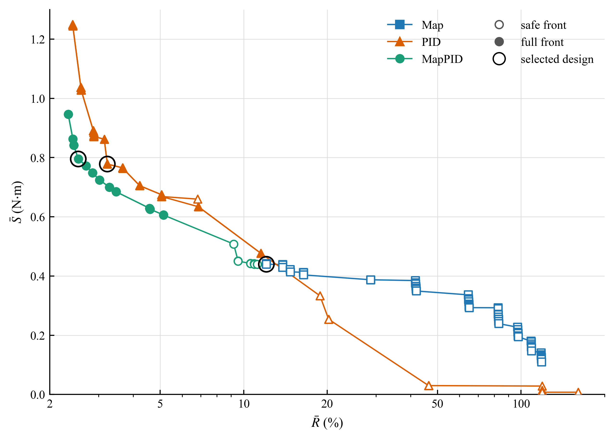

## 4. Controller Parameter Selection

### 4.1. Simulation Setup

**[4.1.1]** The three controllers ran in MATLAB/Simulink against the nonlinear plant of Section 2, with a control period of 1 ms.
**[4.1.2]** Every command went through the assist limit of Eq. (42) before it reached the motor, which behaves as a first-order lag [1]:

$$
\tau_m\dot T_a+T_a=T_{a,lim}
\tag{43}
$$

**[4.1.3]** where $\tau_m=1.59155$ ms is the motor time constant.
**[4.1.4]** The nominal actuator had unit gain and no extra computational delay.
**[4.1.5]** At each step the integral term advanced by forward Euler, the derivative term came from the backward difference of the measured torque passed through the filter of Eq. (35), and
the lead–lag compensator was discretized with the Tustin method.

**[4.1.6]** Independent zero-mean white noise was added to the torsion-bar torque, the vehicle speed and the lateral acceleration, and the noisy values were then quantized.
**[4.1.7]** Each sensor held its output between samples, with the timing given in Table 2.

**Table 2.** Sensor settings in the simulations.

| Quantity | Quantization step | Noise standard deviation | Update period |
|---|---:|---:|---:|
| Torsion-bar torque $T_s$ | 0.01 N·m | 0.01 N·m | 1 ms |
| Vehicle speed $v$ | 1 km/h | 0.38 km/h | 10 ms |
| Lateral acceleration $a_y$ | 0.01 g | 0.01 g | 10 ms |

**[4.1.8]** The torque and acceleration noise levels were modeling choices, each set equal to one quantization step.
**[4.1.9]** The 10 ms interval of the two vehicle signals was an assumption, kept unchanged across the comparison.

**[4.1.10]** The feedback paths used the measurements, but performance was scored on the true model quantities on a 1 ms grid.
**[4.1.11]** For that calculation, $T_{ref}$ was evaluated from uncorrupted speed and lateral acceleration.
**[4.1.12]** Sensor noise therefore affected the results only through the changes it caused in the steering effort and the applied assist torque.

### 4.2. Calibration Case and Performance Measures

**[4.2.1]** Parameters were tuned on a 140 s calibration sequence called CALIB, which consists of nine speed blocks from 20 to 100 km/h in steps of 10 km/h.
**[4.2.2]** The steering-wheel angle came from a dry-road equilibrium table at nominal levels of lateral acceleration.
**[4.2.3]** The plant then produced its own lateral acceleration, and this value reached the torque reference of the controller through the sensor model.
**[4.2.4]** Table 3 lists the 68 evaluation windows.

**Table 3.** CALIB scoring intervals. Acceleration levels specify the prescribed angle, and speeds identify the start of each block.

| Excitation | Nominal condition | Number of windows | Duration per window | Group |
|---|---|---:|---|---|
| Staircase, held portion | 0.10 and 0.18 g at 20 km/h, then 0.10, 0.20 and 0.30 g at 30–100 km/h | 26 | 1 s | static |
| Staircase, entry portion | First 2 s of each level | 26 | 2 s | dyn |
| Continuous steering | Blocks from 40 km/h: period 2 s at 0.30 g, then period 1 s at 0.15 g | 14 | 2 s for period 2 s, 3 s for period 1 s | dyn |
| Friction change | 60 km/h, angle corresponding to 0.30 g, $\mu=0.8\rightarrow0.35\rightarrow0.8$ | 2 | 2 s after each change | mu |

**[4.2.5]** Each staircase level opened with a 1 s ramp and a 2 s hold, with the final second of the hold assigned to the static group.
**[4.2.6]** That interval is the evaluation window, even when a slow candidate is still settling in it.
**[4.2.7]** From the 40 km/h block onwards, every staircase was followed by 1.25 cycles with a 2 s period and 3.5 cycles with a 1 s period.
**[4.2.8]** The first segment started at its peak, so that it joined the preceding hold without a jump.
**[4.2.9]** Speed rose by 10 km/h during these 6 s, except after the 100 km/h staircase.
**[4.2.10]** The scoring used one cycle of the 2 s input and the last three cycles of the 1 s input.
**[4.2.11]** Below 40 km/h, the larger angles that this input needs would load the column inertia more heavily, so the sinusoids were left out there.
**[4.2.12]** The two lower-speed blocks instead had a 3 s transition in which the steering-wheel angle went to zero.

**[4.2.13]** The 60 km/h hold contained a further 10 s at the angle for 0.30 g, which served the friction test.
**[4.2.14]** In that interval, the friction coefficient dropped from 0.8 to 0.35 for 6 s and then returned to 0.8 for 4 s.
**[4.2.15]** The whole sequence began and ended with 2 s of straight-ahead driving.

**[4.2.16]** The dyn group combines the staircase entries and the sinusoidal responses.
**[4.2.17]** For a group $g$, the samples of all its windows were pooled, and the root-mean-square (RMS) error was divided by the mean target magnitude:

$$
R_g=100\frac{\operatorname{RMS}_g(e_T)}
{\operatorname{mean}_g(|T_{ref}|)}
\tag{44}
$$

**[4.2.18]** The tracking error $e_T$ follows Eq. (18), evaluated with the true plant signals as explained in Section 4.1.
**[4.2.19]** The overall measure weights the three groups equally, whatever their lengths:

$$
R=\left[\prod_{g\in\{\mathrm{static},\mathrm{dyn},\mathrm{mu}\}}
\max(R_g,1)\right]^{1/3}
\tag{45}
$$

**[4.2.20]** Both quantities are percentages, so the floor of 1 corresponds to 1%.
**[4.2.21]** Once the error of a group drops below 1%, a further reduction no longer changes $R$.

**[4.2.22]** Assist-torque noise was judged from the applied torque $T_a$ after the motor dynamics.
**[4.2.23]** A first-order smoother with time constant $\tau_S=31.8310$ ms removed the slow part of the signal through the recurrence

$$
T_{a,LP}[k]=(1-\alpha)T_{a,LP}[k-1]+\alpha T_a[k],
\qquad \alpha=\frac{\Delta t}{\tau_S+\Delta t}
\tag{46}
$$

**[4.2.24]** where $\Delta t=0.001$ s and the filter state started at zero.
**[4.2.25]** $S$ is the RMS of the remaining residual over the whole sequence after the first 2 s:

$$
S=\operatorname{RMS}_{2\,\mathrm{s}\le t_k\le140\,\mathrm{s}}
\left(T_a[k]-T_{a,LP}[k]\right),
\qquad t_k=k\Delta t
\tag{47}
$$

**[4.2.26]** This residual contains the fluctuations caused by the sensors as well as the response to rapid steering.
**[4.2.27]** The 26 static windows, collected in the set $\mathcal W$, also gave the largest relative mean error:

$$
e_{rel}=100\max_{w\in\mathcal W}
\frac{|\operatorname{mean}_w(e_T)|}
{\operatorname{mean}_w(|T_{ref}|)}
\tag{48}
$$

**[4.2.28]** Each candidate was run with the five common noise seeds 99990–99994, and its scores are the arithmetic means of $R$ and $S$:

$$
\bar R=\frac{1}{5}\sum_{q=1}^{5}R_q,\qquad
\bar S=\frac{1}{5}\sum_{q=1}^{5}S_q
\tag{49}
$$

**[4.2.29]** The accuracy check used the worst case over the same five realizations:

$$
e_{rel,max}=\max_{q=1,\ldots,5}e_{rel,q}
\tag{50}
$$

**[4.2.30]** Two supplementary diagnostics were also kept, namely the total variation of $T_a$ per second and the fraction of time with reverse assist.
**[4.2.31]** The latter is the share of the samples recorded between 2 and 140 s that have $|T_s|\ge0.5$ N·m and $T_aT_s<0$.

### 4.3. Design Constraints and Acceptance Criteria

**[4.3.1]** PID and MapPID were restricted to $T_d<T_i$, which keeps the tracking time $\sqrt{T_iT_d}$ of the anti-windup between the two constants [14].
**[4.3.2]** Another condition governed how much the filters could slow the response: for a sinusoidal input with a period of 0.5 s, the lag stage of Map and the derivative filter of PID
had to pass at least $1/\sqrt{2}$ of the input amplitude once settled.
**[4.3.3]** MapPID had to meet both conditions, so the filter of its added branch was limited to $\tau_f\le79.6$ ms.

**[4.3.4]** Before nonlinear simulation, the candidates were screened on 68 linearized plants that cover 17 speeds from 20 to 100 km/h in steps of 5 km/h.
**[4.3.5]** At each speed the operating points were $a_y=0.001$ and 0.30 g at $\mu=0.8$, and $a_y=0.001$ and 0.15 g at $\mu=0.2$.
**[4.3.6]** Each loop included the motor response of Eq. (43) and a delay of 1 ms.
**[4.3.7]** This delay was an allowance for implementation in the linear analysis only, and the nominal nonlinear runs followed the setting of Section 4.1.
**[4.3.8]** MapPID was examined at map slopes of 0, 0.25, 0.50, 0.75 and 1 times $K_{max}$, where zero stands for the dead zone in which only the PID branch acts.
**[4.3.9]** The synthesis of Map used the four nonzero values and a stricter version of the same pre-screen.

**[4.3.10]** At the common-seed selection stage, nonlinear acceptance was checked by repeating CALIB under two actuator perturbations.
**[4.3.11]** The first doubled the gain with no extra delay, and the second inserted a delay of 1 ms at unit gain.
**[4.3.12]** Both ran at seed 99990 and were compared with the nominal response.
**[4.3.13]** The three $R$ scores had to be finite and positive, and the ratios of perturbed to nominal $R$ had to satisfy

$$
\rho_{gain}=\frac{R_{gain}}{R_{nom}}\le2,\qquad
\rho_{delay}=\frac{R_{delay}}{R_{nom}}\le2
\tag{51}
$$

**[4.3.14]** These tests assess only the simulated CALIB response in the stated cases.
**[4.3.15]** The accuracy requirement was $e_{rel,max}\le10\%$, applied to the static-window measure of Eq. (50).

### 4.4. Parameter Search and Final Selection

**[4.4.1]** Table 4 gives the search bounds.
**[4.4.2]** Map had two outer variables, the slope limit $K_{max}$ and a minimum amplitude ratio $g_{min}$ for the settled response of its lag stage to a sinusoid with a period of 0.5 s.
**[4.4.3]** The lag stage was left out at $g_{min}=1$.
**[4.4.4]** For every pair of these two values, an inner grid minimized the initial jump of the command after a unit step in the measured torque at slope $K_{max}$, subject to the synthesis
constraints.
**[4.4.5]** Ties were ranked by the linear pre-screen.

**Table 4.** Parameter bounds for the outer search. All coordinates were logarithmic.

| Controller | Variable | Lower bound | Upper bound |
|---|---|---:|---:|
| Map | $K_{max}$ | 1 | 30 |
| Map | $g_{min}$ | $1/\sqrt{2}$ | 1 |
| PID and MapPID | $K_p$ | 0.01 | 30 |
| PID and MapPID | $T_i$ (s) | 0.002 | 10 |
| PID and MapPID | $T_d$ (s) | 0.020 | 0.796 |
| PID and MapPID | $N$ | 8 | 20 |

**[4.4.6]** The coarse grid for the first stage of Eq. (26) covered $\tau_{1,in}$ from 2 to 200 ms and the ratio $\tau_{1,in}/\tau_{1,out}$ from 1.2 to 300.
**[4.4.7]** For the second stage of Eq. (27), $\tau_{2,in}$ ranged from 8.33333 to 125 ms and $\tau_{2,in}/\tau_{2,out}$ from 0.1 to 0.9.
**[4.4.8]** The local refinement was allowed to widen these intervals, within $\tau_{1,out}\ge0.318310$ ms and $\tau_{2,out}\le333.333$ ms.

**[4.4.9]** MapPID kept the selected map and compensator fixed and varied only its four PID parameters.
**[4.4.10]** PID used the same bounds, and $K_i$, $K_d$ and $\tau_f$ followed from the standard-form relations of Section 3.
**[4.4.11]** The interval for $N$ comes from [14], and the lower bound $T_d=20$ ms keeps $\tau_f=T_d/N$ at or above one control period everywhere in the box.
**[4.4.12]** The other limits define the finite region considered in the comparison.

**[4.4.13]** Each coordinate was mapped to $[0,1]$ before the coarse-to-fine search.
**[4.4.14]** The coarse grid had 13 levels on each Map axis (169 pairs) and four levels per variable for the PID structures (256 combinations each).
**[4.4.15]** The local noise seeds were 00000 for Map, 10000 for PID and 30000 for MapPID.
**[4.4.16]** For PID and MapPID, the refinement was centered on the design with the smallest $RS$ among those passing the structural, linear and local accuracy checks.
**[4.4.17]** The fine grid placed three values on each axis, with initial steps of $1/24$ for Map and $1/6$ for the PID structures.
**[4.4.18]** It moved with every improvement and halved its spacing whenever the best point stayed unchanged.
**[4.4.19]** The search ended after six refinement layers or when the step fell below 0.02.

**[4.4.20]** The common-seed pool held all locally simulated designs that passed the linear screen, including those that missed the 10% accuracy threshold.
**[4.4.21]** A point is Pareto-optimal within a set if no other member lowers one of $R$ and $S$ without raising the other.
**[4.4.22]** In phase 1, the front found at the local seed was evaluated on the five common seeds of Section 4.2.
**[4.4.23]** For each controller, $\sigma_R$ and $\sigma_S$ were the median coefficients of variation over these front points, each coefficient being the standard deviation divided by the
mean across the five realizations.
**[4.4.24]** Phase 2 admitted further points unless some phase-1 point $f$ satisfied both inequalities for the candidate $p$:

$$
R_{0,f}(1+3\sigma_R)\le R_{0,p},\qquad
S_{0,f}(1+3\sigma_S)\le S_{0,p}
\tag{52}
$$

**[4.4.25]** The subscript 0 marks the scores at the local seed, and the three-sigma margin allows for the scatter between noise seeds.
**[4.4.26]** All phase-1 points entered the evaluation set.

**[4.4.27]** Two fronts were built from the common-seed results.
**[4.4.28]** The safe front left out the accuracy condition, and the full front also required $e_{rel,max}\le10\%$.
**[4.4.29]** The nondominated points were then stress-tested, and failing points were removed and the fronts recomputed until every remaining point had passed.
**[4.4.30]** The final selection took the full front, with safe as a fallback when full was empty.
**[4.4.31]** The balance criterion was

$$
J=\bar R\,\bar S
\tag{53}
$$

**[4.4.32]** Points within 3% of the smallest $J$ on the chosen front were treated as tied, and the final choice among them followed the ranking of the linear pre-screen.
**[4.4.33]** All three structures shared this rule, and the selected designs were fixed for the independent evaluation.

### 4.5. Calibration Results and Selected Parameters

**[4.5.1]** Table 5 summarizes the candidate pool and the two final fronts.
**[4.5.2]** The accuracy column counts the passing points before stress rejection, so its entries need not lie on the full front.

**Table 5.** Search candidates and final Pareto fronts. All points on the reported fronts passed the nonlinear acceptance tests.

| Controller | Locally simulated | Common-seed set | Accuracy passes in set | safe front | full front |
|---|---:|---:|---:|---:|---:|
| Map | 149 | 80 | 17 | 58 | 0 |
| PID | 184 | 134 | 99 | 44 | 31 |
| MapPID | 225 | 187 | 142 | 33 | 22 |

**[4.5.3]** For Map, all 17 points that met the 10% requirement failed the nonlinear acceptance check, so the full front stayed empty.
**[4.5.4]** The Map design therefore came from the safe front.

**[4.5.5]** Fig. 7 plots both fronts of each controller.
**[4.5.6]** The full fronts of PID and MapPID also differed at comparable tracking targets.
**[4.5.7]** With $\bar R$ limited to 3%, the lowest $\bar S$ was 0.8713 N·m for PID and 0.7486 N·m for MapPID.
**[4.5.8]** At $\bar R\le6\%$, the values were 0.6685 and 0.6059 N·m.
**[4.5.9]** PID, however, offered quieter full designs at larger tracking errors, so the advantage of either controller depended on the part of the front considered.

**Fig. 7.** Pareto fronts of Map, PID and MapPID on the common-seed evaluation set. Filled markers lie on the full front and open markers on the safe front only.
Circles mark the designs selected with Eq. (53), and the horizontal axis is logarithmic.

**[4.5.10]** Table 6 lists the settings chosen with Eq. (53) and its tie rule.
**[4.5.11]** The identical map columns show which parameters stayed frozen while the parallel branch was tuned, and $K_{aw}$ follows Eq. (38) for both PID structures.

**Table 6.** Selected controller parameters. A dash means not applicable.

| Parameter | Map | PID | MapPID |
|---|---:|---:|---:|
| $K_{max}$ | 6.77455 | - | 6.77455 |
| $T_{s0}$ (N·m) | 0.300 | - | 0.300 |
| $\tau_{1,in}$ (ms) | 29.8499 | - | 29.8499 |
| $\tau_{1,out}$ (ms) | 1.48530 | - | 1.48530 |
| $\tau_{2,in}$ (ms) | 35.5523 | - | 35.5523 |
| $\tau_{2,out}$ (ms) | 93.5587 | - | 93.5587 |
| $K_p$ | - | 2.90376 | 2.08008 |
| $T_i$ (ms) | - | 34.1995 | 23.9826 |
| $T_d$ (ms) | - | 23.3180 | 23.3180 |
| $N$ | - | 19.2508 | 14.1841 |
| $K_i$ ($\mathrm{s}^{-1}$) | - | 84.9065 | 86.7330 |
| $K_d$ (s) | - | 0.0677100 | 0.0485034 |
| $\tau_f$ (ms) | - | 1.21127 | 1.64395 |
| $K_{aw}$ ($\mathrm{s}^{-1}$) | - | 35.4115 | 42.2869 |

**[4.5.12]** Both derivative times, about 23.3 ms, lie close to the lower search bound of 20 ms.
**[4.5.13]** The reported choice is therefore conditional on this range, and Table 7 gives the matching CALIB scores.

**Table 7.** Performance of the selected designs on CALIB. Means and maximum bias use five seeds, and the perturbation ratios use seed 99990.

| Quantity | Map | PID | MapPID |
|---|---:|---:|---:|
| $\bar R$ (%) | 12.0719 | 3.2241 | 2.5330 |
| $\bar S$ (N·m) | 0.4397 | 0.7782 | 0.7953 |
| $J$ (%·N·m) | 5.3085 | 2.5089 | 2.0145 |
| $e_{rel,max}$ (%) | 26.2366 | 2.0861 | 1.8056 |
| $\rho_{gain}$ | 1.931 | 0.698 | 0.810 |
| $\rho_{delay}$ | 1.000 | 1.029 | 1.028 |
| Front used for selection | safe | full | full |

**[4.5.14]** Compared with Map, MapPID cut $\bar R$ by about 79%, while the fast component of the applied assist torque grew.
**[4.5.15]** Map had the smallest $\bar S$, but its largest static-window error reached 26.2%.
**[4.5.16]** The added feedback brought this error below the 10% requirement without changing the calibrated map.
**[4.5.17]** Against PID, the selected MapPID point lowered $J$ by about 19.7% and raised $\bar S$ by 2.2%.
**[4.5.18]** The shared rule thus settled on a different balance of error and noise for each structure.
**[4.5.19]** These are calibration results for one simulated vehicle, and the fixed parameter sets form the basis of the tests in Section 5.
