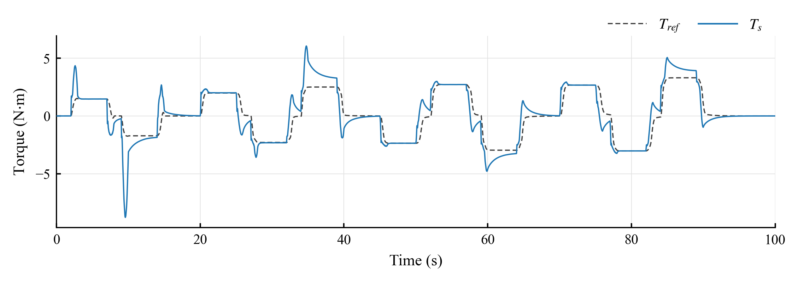
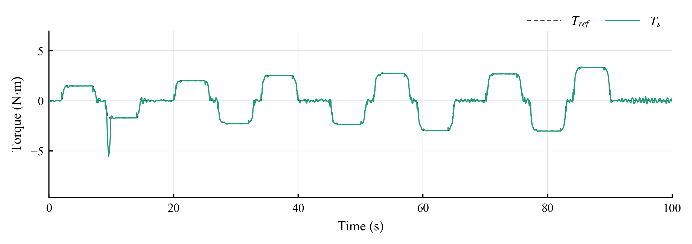
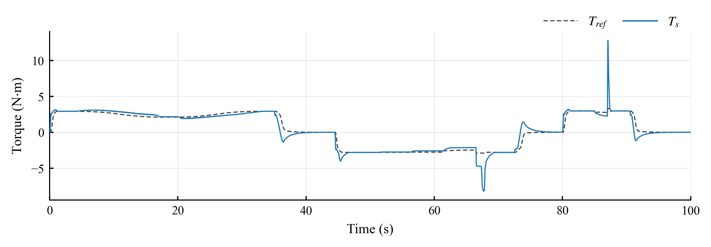
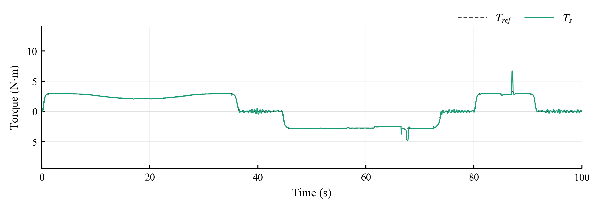
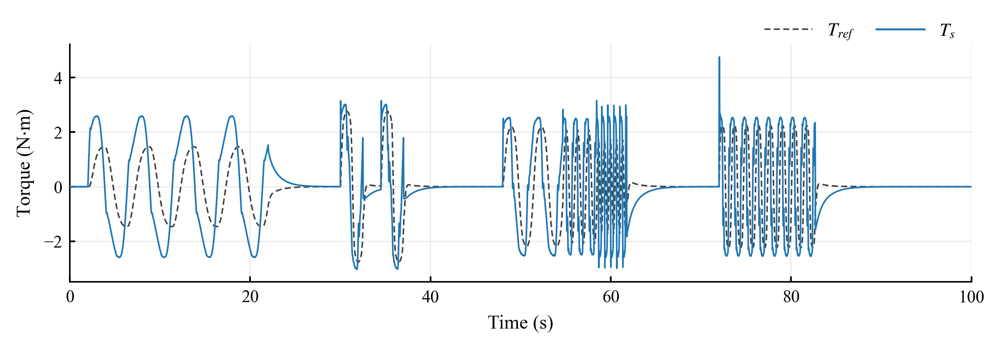
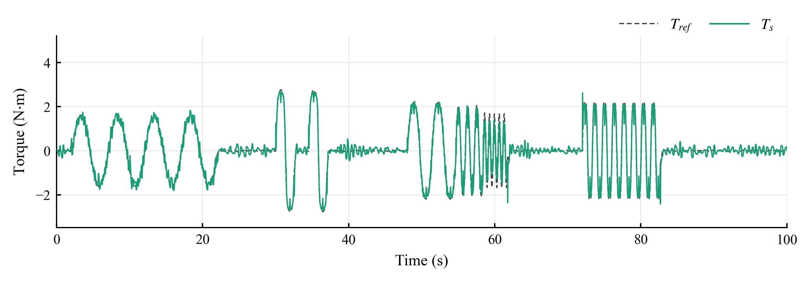
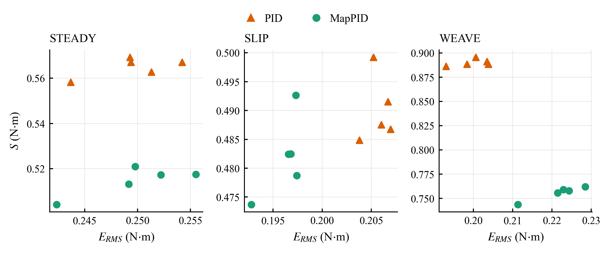

## 5. Evaluation Results

### 5.1. Evaluation Protocol

**[5.1.1]** With the parameters of Table 6 held fixed, the controllers were tested on three 100 s sequences named STEADY, SLIP and WEAVE.
**[5.1.2]** All controllers ran with the same nonlinear vehicle model, assist limits, sensor settings and prescribed steering-wheel angle.
**[5.1.3]** Five noise seeds, 99995–99999, were common to all structures and separate from the CALIB seeds of Section 4.
**[5.1.4]** Reported statistics are arithmetic means and sample standard deviations across those runs, which represent noise realizations for one vehicle.

**Table 8.** Evaluation sequences. Acceleration levels specify the nominal dry-road condition used to generate the steering-wheel angle.

| Sequence | Prescribed conditions | Scored windows |
|---|---|---:|
| STEADY | Dry road, 25, 45, 65 and 85 km/h, nominal lateral acceleration from 0.15 to 0.38 g in magnitude | 11 |
| SLIP | Speed decrease and increase in a turn, stepped adhesion reduction, and a 2 s water patch | 12 |
| WEAVE | Steering near center, paired lane changes, successively shorter steering periods, and continuous steering at low adhesion | 8 |

**[5.1.5]** Their timing and their combinations of speed, steering level and adhesion differ from those in CALIB.
**[5.1.6]** The nominal acceleration defines the angle input, while the plant determines the actual $a_y$ and hence $T_{ref}$.
**[5.1.7]** A friction drop can therefore change both the road reaction and the reference.
**[5.1.8]** Performance was evaluated from true model signals on the 1 ms grid, although each controller received noisy, quantized measurements.

**[5.1.9]** Whole-sequence tracking was assessed after the initial 2 s by

$$
E_{RMS}=\sqrt{\frac{1}{|\mathcal I|}\sum_{k\in\mathcal I}e_T[k]^2},
\qquad
\mathcal I=\{k:2\,\mathrm{s}\le t_k\le100\,\mathrm{s}\}
\tag{54}
$$

**[5.1.10]** where $e_T$ follows Eq. (18) and $|\mathcal I|$ is the number of scored samples.
**[5.1.11]** Unlike the CALIB aggregate $R$ of Eq. (45), this measure is not normalized and is expressed in N·m.
**[5.1.12]** The assist-torque residual $S$ kept the smoother of Eq. (46) but was computed over the interval of Eq. (54).
**[5.1.13]** This residual contains both sensor-induced fluctuations and the response to rapid steering, so a lower value alone does not imply better tracking or
subjective steering comfort.

**[5.1.14]** For a window $w$ in which the target has a nonzero mean and keeps its direction, the signed relative bias was

$$
\epsilon_w=
100\,\operatorname{sgn}\!\left(\operatorname{mean}_w T_{ref}\right)
\frac{\operatorname{mean}_w(e_T)}
{\operatorname{mean}_w(|T_{ref}|)}
\tag{55}
$$

**[5.1.15]** A positive value means more torsion-bar torque than requested, and a negative value means lighter effort.
**[5.1.16]** Reversing inputs were assessed primarily by RMS error within their windows, since signed averaging can conceal deviations of opposite sign.

### 5.2. Steady Steering on a Dry Road

**[5.2.1]** STEADY held the friction coefficient at $\mu=0.8$ and applied eleven steering levels at the four speeds in Table 8.
**[5.2.2]** Each level comprised a 1 s entry ramp, a 4 s hold, a 1 s return and 1 s of straight-ahead driving.
**[5.2.3]** The last second of each hold formed its scoring window.
**[5.2.4]** The largest nominal accelerations were 0.35 g at 45 and 65 km/h and 0.38 g at 85 km/h.

**[5.2.5]** Table 9 gives the whole-sequence results, and Figs. 8 and 9 show the torsion-bar torque of Map and MapPID against the target.
**[5.2.6]** The time plots in Figs. 8–13 leave out PID, because it overlaps MapPID at their scale.
**[5.2.7]** The whole-sequence $E_{RMS}$ of the two differs by 0.0002 N·m in STEADY and by at most 0.022 N·m in the other sequences, which is hard to resolve on axes that span 8 to 21 N·m.
**[5.2.8]** PID therefore enters through the tables, and its difference from MapPID is examined over the five seeds in Section 5.5.

**Table 9.** Whole-sequence $E_{RMS}$ and $S$ in STEADY over 2–100 s. Entries are the mean ± sample standard deviation across five noise seeds.

| Controller | $E_{RMS}$ (N·m) | $S$ (N·m) |
|---|---:|---:|
| Map | 1.0585 ± 0.0007 | 0.1982 ± 0.0009 |
| PID | 0.2496 ± 0.0039 | 0.5649 ± 0.0044 |
| MapPID | 0.2498 ± 0.0049 | 0.5146 ± 0.0065 |

**Fig. 8.** Torsion-bar torque $T_s$ and target $T_{ref}$ of Map in STEADY.

**Fig. 9.** Torsion-bar torque $T_s$ and target $T_{ref}$ of MapPID in STEADY.

**[5.2.9]** In Fig. 8, Map reaches the target level only roughly.
**[5.2.10]** After each large step its torque overshoots and then decays slowly: at 45 km/h and +0.35 g it peaks at 6.1 N·m against a target of 2.5 N·m, and in the last second of the hold it
is still 32.30% above the target (Table 10).
**[5.2.11]** The same offset appears at 65 and 85 km/h, where the final-second deviations are 10.78% and 19.26%, and a smaller one of 9.53% shows up at 25 km/h and 0.25 g.
**[5.2.12]** These offsets agree with the limited correction that a fixed map slope can provide, but settling time and column friction were not separated in this comparison.
**[5.2.13]** At five of the milder levels, the bias of Map was already below 0.06%, and its window RMS error was lower than that of either feedback structure.
**[5.2.14]** There the feedback had little offset to remove.

**Table 10.** Signed relative bias in the scoring windows at three high STEADY levels. Entries are mean ± sample standard deviation, in percent, across five noise seeds.

| Condition | Map | PID | MapPID |
|---|---:|---:|---:|
| 45 km/h, +0.35 g | 32.3002 ± 0.0029 | −0.0185 ± 0.0610 | −0.0358 ± 0.0456 |
| 65 km/h, −0.35 g | 10.7759 ± 0.0185 | −0.0334 ± 0.1016 | −0.0441 ± 0.0843 |
| 85 km/h, +0.38 g | 19.2623 ± 0.0232 | −0.0264 ± 0.0571 | −0.0373 ± 0.0634 |

**[5.2.15]** In Fig. 9, MapPID holds the target at every level.
**[5.2.16]** A short oscillation follows each step and dies out within the hold, so that the bias in the last second stays below 0.05% at the three strongest levels and under 0.43% in all
eleven windows, for PID as well.
**[5.2.17]** This agrees with the integral action of both feedback structures, although a 1 s window at the end of a 4 s hold does not prove a true steady state.

**[5.2.18]** The straight-ahead interval at the end of the sequence has a target close to zero.
**[5.2.19]** There the torque of Map remains flat, with a standard deviation of 0.015 N·m, while MapPID ripples with 0.17 N·m and PID with 0.14 N·m.
**[5.2.20]** This is consistent with the dead zone of the map keeping the assist off near zero torque, while the feedback branch reacts to the sensor noise in the measured torque.
**[5.2.21]** It also fits the larger assist-torque residual of MapPID in Table 9, 0.5146 against 0.1982 N·m for Map.

**[5.2.22]** PID and MapPID reached almost the same whole-sequence $E_{RMS}$, about 0.25 N·m.
**[5.2.23]** This value is far above their holding errors, because the RMS also covers the entries and exits, where transient deviations remain.
**[5.2.24]** MapPID produced a lower residual than PID, with $S=0.5146$ compared with 0.5649 N·m.
**[5.2.25]** Map had the smallest $S$ and the largest overall tracking error.

### 5.3. Changes in Speed and Road Adhesion

**[5.3.1]** SLIP began with a 13 s deceleration from 90 to 45 km/h, a 3 s hold and a 13 s acceleration back to 90 km/h, with $\mu=0.8$.
**[5.3.2]** Throughout, the angle followed the dry-road equilibrium table for a nominal lateral acceleration of 0.20 g.
**[5.3.3]** The subsequent staircase kept 60 km/h and the angle for −0.30 g while $\mu$ stepped from 0.8 through 0.5, 0.33 and 0.24 before returning to 0.8.
**[5.3.4]** Each lower coefficient was held for 5 s, and the last 2 s of each level were scored.
**[5.3.5]** The final water patch reduced the coefficient from 0.8 to 0.2 for 2 s at 80 km/h and the angle for +0.25 g.
**[5.3.6]** Because the angle stayed fixed in both tests, the lateral acceleration and the target torque depended on the force that the tires could still produce.

**[5.3.7]** Table 11 gives the whole-sequence results, and Figs. 10 and 11 show the torque of Map and MapPID.

**Table 11.** Whole-sequence $E_{RMS}$ and $S$ in SLIP over 2–100 s. Entries are the mean ± sample standard deviation across five noise seeds.

| Controller | $E_{RMS}$ (N·m) | $S$ (N·m) |
|---|---:|---:|
| Map | 0.6895 ± 0.0001 | 0.2028 ± 0.0009 |
| PID | 0.2057 ± 0.0013 | 0.4900 ± 0.0057 |
| MapPID | 0.1962 ± 0.0019 | 0.4820 ± 0.0069 |

**Fig. 10.** Torsion-bar torque $T_s$ and target $T_{ref}$ of Map in SLIP. The friction coefficient is lowered between 51.5 and 66.5 s and between 85 and 87 s.

**Fig. 11.** Torsion-bar torque $T_s$ and target $T_{ref}$ of MapPID in SLIP.

**[5.3.8]** During the speed ramps, the torque of Map drifts away from the target in Fig. 10, above it as the vehicle slows and below it as the vehicle accelerates.
**[5.3.9]** The window RMS errors were 0.2986 and 0.2503 N·m, with biases of +11.6% and −9.3%, so pooling the two windows would hide much of the deviation.
**[5.3.10]** The corresponding values for MapPID were 0.0140 and 0.0124 N·m, compared with 0.0205 and 0.0180 N·m for PID.

**[5.3.11]** As the coefficient fell, the bias of Map grew from −1.52% at $\mu=0.5$ to −6.42% at 0.33 and −13.94% at 0.24, so the effort became steadily lighter than the target.
**[5.3.12]** A torque below the target means that the assist exceeds what the slippery road calls for.
**[5.3.13]** In Fig. 10 the torque of Map is smaller in magnitude than the target during the last level, while MapPID in Fig. 11 overlaps it.
**[5.3.14]** PID and MapPID kept the bias within ±0.16% at all three levels.

**Table 12.** Signed relative bias in two SLIP windows. The first uses the final 2 s of the level at $\mu=0.24$, and the second covers the 2 s water patch including the transient. Entries
are mean ± sample standard deviation, in percent, across five noise seeds.

| Condition | Map | PID | MapPID |
|---|---:|---:|---:|
| Held angle, $\mu=0.24$ | −13.9400 ± 0.0097 | 0.1251 ± 0.1255 | 0.1234 ± 0.1141 |
| Water patch | −12.5616 ± 0.0188 | −0.8428 ± 0.0786 | −0.5141 ± 0.0655 |

**[5.3.15]** The largest deviations in both figures occur when adhesion returns, at 66.5 and 87 s.
**[5.3.16]** At 87 s the torque of Map reaches 12.8 N·m against a target of 3.3 N·m, while that of MapPID rises to 6.7 N·m.
**[5.3.17]** The step at 66.5 s shows the same pattern, with extremes of −8.2 and −4.8 N·m.
**[5.3.18]** A plausible reading is that the road reaction rises abruptly while the assist, which had adapted to the slippery surface, lags behind.
**[5.3.19]** Inside the patch itself, the bias was −12.56% for Map, −0.84% for PID and −0.51% for MapPID (Table 12), and the RMS error fell from 0.3836 N·m for Map to 0.0875 N·m for PID and
0.0462 N·m for MapPID.
**[5.3.20]** This RMS value covers the adhesion transition and does not measure steady-state error.

**[5.3.21]** Over the entire sequence, MapPID lowered $E_{RMS}$ from Map's 0.6895 to 0.1962 N·m without receiving an estimate of road friction.
**[5.3.22]** The difference from PID was small, about 4.6%, although it exceeded the seed-to-seed scatter.
**[5.3.23]** Their assist-torque residuals, 0.4820 N·m for MapPID and 0.4900 N·m for PID, differed by about as much as the noise realizations do.

### 5.4. Continuous Steering

**[5.4.1]** WEAVE began with four cycles of near-center steering on the dry road at 95 km/h, with nominal 0.05 g and a 5 s period.
**[5.4.2]** Two identical single-cycle lane-change inputs followed at 80 km/h, nominal 0.20 g, and a period of 2.5 s.
**[5.4.3]** The first maneuver remained dry, while the second included a 0.4 s patch at $\mu=0.2$ shortly after the steering peak.
**[5.4.4]** At 70 km/h, nominal 0.10 g was applied with successively shorter periods of 3.3333, 1.2500 and 0.6667 s.
**[5.4.5]** The sequence ended with eight cycles at 60 km/h, nominal 0.15 g, $\mu=0.3$, and a period of 1.3333 s.

**[5.4.6]** Table 13 gives the whole-sequence results, and Figs. 12 and 13 show the torque of Map and MapPID.

**Table 13.** Whole-sequence $E_{RMS}$ and $S$ in WEAVE over 2–100 s. Entries are the mean ± sample standard deviation across five noise seeds.

| Controller | $E_{RMS}$ (N·m) | $S$ (N·m) |
|---|---:|---:|
| Map | 1.4510 ± 0.0001 | 0.2896 ± 0.0006 |
| PID | 0.1998 ± 0.0044 | 0.8900 ± 0.0036 |
| MapPID | 0.2217 ± 0.0064 | 0.7557 ± 0.0071 |

**Fig. 12.** Torsion-bar torque $T_s$ and target $T_{ref}$ of Map in WEAVE. Lane changes start at 30.0 and 34.5 s, the stepped periods at 48.0 s and $\mu=0.3$ at 66.0 s.

**Fig. 13.** Torsion-bar torque $T_s$ and target $T_{ref}$ of MapPID in WEAVE.

**[5.4.7]** In Fig. 12, Map does not reproduce the shape of the target.
**[5.4.8]** Around the center, where the target amplitude is 1.6 N·m, its torque climbs to 2.6 N·m and moves in abrupt steps that come ahead of the target.
**[5.4.9]** The plots do not separate the cause, but a map with a dead zone and a high slope tends to change the assist in jumps.
**[5.4.10]** In Fig. 13, MapPID follows the target through the whole sequence, with small oscillations that grow when the steering period gets shorter.

**Table 14.** Window RMS tracking error in the 70 km/h continuous-steering segment. Values are mean ± sample standard deviation in N·m across five noise seeds.

| Steering period (s) | Map | PID | MapPID |
|---|---:|---:|---:|
| 3.3333 | 1.7069 ± 0.0001 | 0.1690 ± 0.0094 | 0.1822 ± 0.0123 |
| 1.2500 | 2.3540 ± 0.0001 | 0.2761 ± 0.0121 | 0.3088 ± 0.0125 |
| 0.6667 | 2.6379 ± 0.0002 | 0.4622 ± 0.0071 | 0.5224 ± 0.0058 |

**[5.4.11]** Shortening the period increased the error for all three controllers in Table 14.
**[5.4.12]** MapPID stayed well below Map but tracked less closely than PID, with a gap that grew from about 8% to 13%.
**[5.4.13]** PID also kept the smaller error in the near-center and low-adhesion stretches.
**[5.4.14]** These results show a limitation of the selected parallel design under rapid reversals.
**[5.4.15]** They do not identify a single cause, since the two feedback branches had different tuned parameters and their contributions were not separated.

**[5.4.16]** The lane changes reversed this ranking.
**[5.4.17]** In the window of the second maneuver that contained the water patch, the RMS error was 0.0790 N·m for MapPID, 0.1060 N·m for PID and 2.2962 N·m for Map.
**[5.4.18]** The corresponding phase on the dry road gave 0.0644, 0.0889 and 2.0899 N·m in the same order.
**[5.4.19]** Map was thus far from the target even on the dry road.
**[5.4.20]** Its signed bias shifted from −76.59% in the dry reference window to −86.65% in the wet one, a difference of −10.06 percentage points.
**[5.4.21]** The complete wet-window offset therefore cannot be attributed to the water patch alone.

**[5.4.22]** For the full WEAVE sequence, MapPID had 10.9% greater $E_{RMS}$ than PID but a 15.1% smaller assist-torque residual.
**[5.4.23]** Because $S$ also includes the response to steering reversals, this gap does not isolate sensor noise.

### 5.5. Overall Results and Limitations

**[5.5.1]** With the map and compensator unchanged, MapPID reduced the whole-sequence RMS tracking error of Map by factors of 4.24 in STEADY, 3.51 in SLIP and 6.54 in WEAVE.
**[5.5.2]** The price was a larger assist-torque residual, which rose from 0.20–0.29 N·m for Map to 0.48–0.76 N·m for MapPID.

**[5.5.3]** Compared with PID, MapPID tracked about equally well in STEADY, with a small gain in SLIP and a loss in WEAVE.
**[5.5.4]** Its $S$ was lower by 8.9% in STEADY and 15.1% in WEAVE, while the 1.6% difference in SLIP lay within the seed scatter (Fig. 14).
**[5.5.5]** This ordering differs from CALIB, where the selected MapPID point had a 2.2% higher residual.
**[5.5.6]** The balance therefore depends on the excitation and on the selected parameters, and the results do not establish a general ranking of the two structures in
assist-torque noise.

**Fig. 14.** Whole-sequence $E_{RMS}$ and $S$ of PID and MapPID for the five noise seeds in STEADY, SLIP and WEAVE.

**[5.5.7]** The evaluation covers one simulated vehicle, with the steering-wheel angle prescribed independently of the effort felt by a driver.
**[5.5.8]** It excludes corrective human responses, and the five seeds characterize sensitivity to sensor noise in that model.
**[5.5.9]** The influence of vehicle parameters and agreement with measured data remain untested.
**[5.5.10]** A smaller torque error alone also does not demonstrate improved path following or safety.
**[5.5.11]** Within these limits, the added branch reduced the torque deviations of the fixed map, but it tracked less closely than PID during rapid steering, and hardware tests
are still needed.
